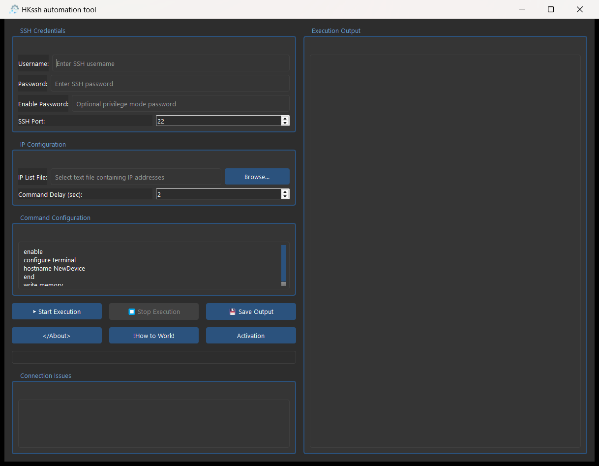

<h1 align="center">HKssh</h1>

<p align="center"><b>Run command lists on many network devices over SSH from one window</b></p>

<p align="center">
  
  
  
  [](https://github.com/alisadhk/hkssh/releases/latest)
</p>

---

## Overview
HKssh is a PyQt5 automation tool that connects to a list of devices via SSH (paramiko), sends a block of commands to each one and shows the output live. It is meant for repetitive network-engineering tasks on routers and switches.

## Features
- SSH username/password plus optional Enable password
- Custom SSH port and delay between commands
- IP list loaded from a text file (one IP per line)
- Command block editor
- Start / Stop execution, progress bar and Save Output
- Separate panel for connection issues and invalid IP addresses
- 30-day trial with activation dialog

## Screenshots
<p align="center"></p>

## Download and install
### Option A - Ready-to-run download (recommended)
1. Open the **[Releases page](https://github.com/alisadhk/hkssh/releases/latest)**.
2. Download the file(s) listed under **Assets**:

| File | Size |
|---|---|
| `HKssh.exe` | 41.8 MB |
| `HKssh-archive.rar` | 41.3 MB |

3. Run it. 

### Option B - Run from source
Requirements: Windows 10/11 and Python 3.10+.

```bash
git clone https://github.com/alisadhk/hkssh.git
cd hkssh
python -m pip install -r requirements.txt
python 1111.py
```

## How to use
1. Start HKssh and enter the SSH **Username**, **Password** and, if needed, the **Enable Password**.
2. Click **Browse...** and select a text file with one IP address per line.
3. Type the commands to run in **Command Configuration** and set the **Command Delay**.
4. Press **Start Execution**; follow the output on the right and any errors in **Connection Issues**.
5. Use **Save Output** to store the results in a file.

## Configuration and privacy
- All sensitive values from the original private version (passwords, tokens, license codes, user names, internal IP addresses, personal names and links) were replaced with `*****`.
- The activation code and the HMAC secret are masked (`*****`). Set your own values in 1111.py before building a licensed version, or use the trial.

## Build the executable yourself
```bash
python -m pip install pyinstaller
python -m PyInstaller --noconfirm 1111.spec
```
The executable is created in the `dist/` folder.

## Notes
- Only automate devices you are authorized to administer.

---

<p align="center">Maintained by <a href="https://github.com/alisadhk">@alisadhk</a> - last update 2025-10-28</p>